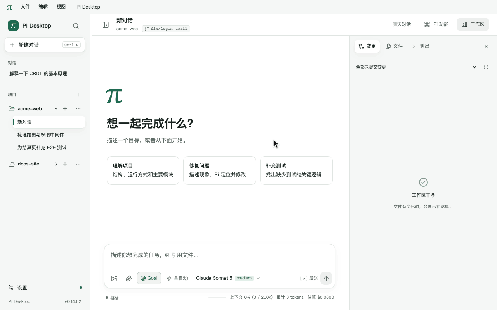
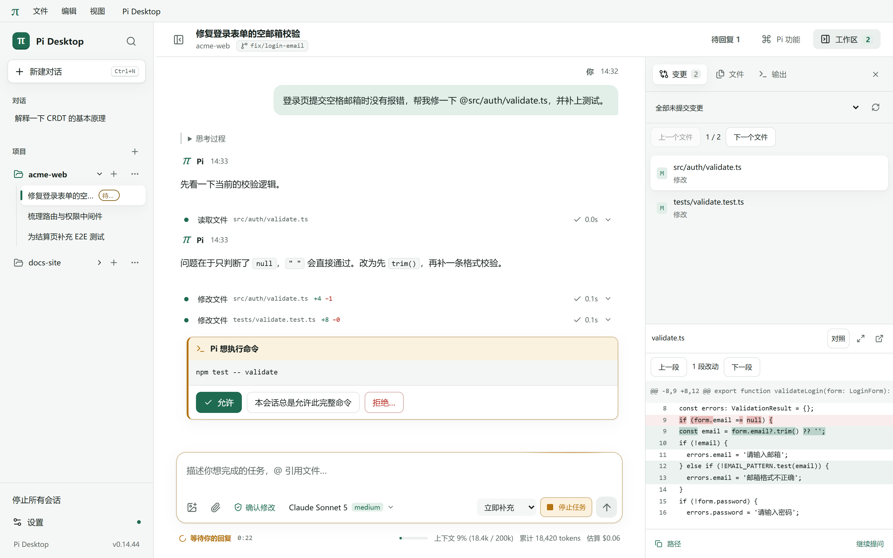
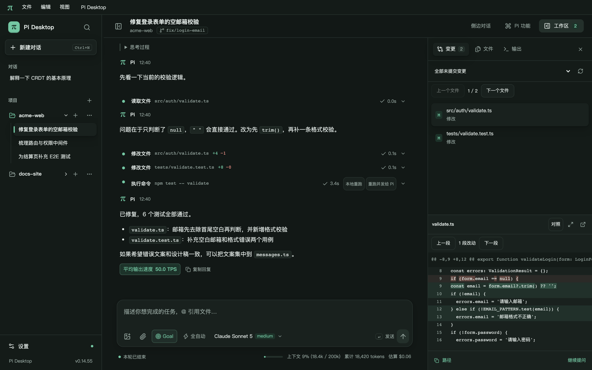

<div align="center">


# Pi Desktop

**A native desktop workspace for the [Pi Coding Agent](https://www.npmjs.com/package/@earendil-works/pi-coding-agent).**<br />
The freedom of the terminal, the clarity of a desktop app.

[](https://github.com/yeyuProject/pi-desktop-gui/releases/latest)
[](https://github.com/yeyuProject/pi-desktop-gui/actions/workflows/ci.yml)
[](https://github.com/yeyuProject/pi-desktop-gui/releases)
[](#installation)
[](LICENSE)

**English** · [简体中文](README.zh-CN.md)

[Features](#features) · [Installation](#installation) · [Usage](#usage) · [FAQ](#faq) · [Contributing](#contributing)

<br />



</div>

> [!NOTE]
> The user interface is currently available in **Simplified Chinese only**. Pi itself and your conversations work in any language.

## Why Pi Desktop?

CLI coding agents are fast and composable, but a terminal gets cramped when you need to review large diffs, explore several approaches in parallel, paste screenshots, or manage MCP servers and Skills. Pi Desktop puts a desktop UI on top of the Pi CLI you already have:

- **Runs on your machine.** The app drives your local `pi` over stdio RPC (JSON Lines). There is no extra relay service between the desktop and the agent.
- **Shares everything with the terminal.** Sessions, model credentials and extensions are the same ones Pi uses. Hand a session over to the terminal with **Continue in Pi terminal**, and open terminal sessions from the desktop.
- **Conversation first, review alongside.** Keep a clean chat flow; open the workspace panel to review changes and diffs, and undo file changes when needed.

Sessions and workspaces stay on your machine. Model requests go to whichever provider you configured in Pi, and remote MCP servers may use the network — "local" does not mean offline inference.

## Features

- **Responsive long conversations** — Reuse completed Markdown sections while replies stream, keep turn navigation compact, load draft images for the selected chat, and save pending edits immediately when switching. Pi environment checks run after the workspace opens.
- **Compact conversation history** — Thinking from one user turn shares a single collapsible section. Completed turns start collapsed; search reveals the original text, and you can collapse all thinking at once.
- **Visible agent workflow** — Streamed thinking, tool calls with arguments and exit status, inline diffs for every edit, plus estimated current context/window capacity, clearly labeled cumulative session tokens, cache breakdown and estimated cost.
- **Image attachments** — Paste or drop images even when the system omits their file type; selecting a project image through `@` also attaches the image. Supports PNG, JPEG, WebP and GIF, up to 8 images, 8 MiB each and 16 MiB combined.
- **Per-turn undo** — In Git projects, a snapshot is taken before each run (stored outside your repo's `.git`). Open either the repository root or a subdirectory as your project. Undo a whole turn or roll back individual files. Side effects of shell commands are not covered.
- **Tool approval** — Choose _Auto_, _Confirm changes_ or _Read-only_ per session. Approve once, always allow for the session, or deny with a reason.
- **Branching conversations** — Edit and resend any message, fork a new branch, or clone the active one to try a different approach.
- **Ecosystem control center** — Manage model providers (API key / OAuth / any OpenAI-compatible endpoint), MCP servers, Skills, extensions and prompt templates without hand-editing config files.
- **Quick chat or full project** — Start a standalone chat without a repository, or open a project to get the file tree, Git changes and snapshots.
- **Concurrent conversations** — Each connected chat has its own Pi process. Switch chats while tasks continue. Model and reasoning changes apply to the next new user task; tool continuations and mid-run additions retain the current settings. A double <kbd>Esc</kbd> stops only the current chat.
- **Steer while it runs** — Add instructions mid-run (steer) or queue follow-ups within each conversation.
- **Clear retry progress** — See retry backoff and response wait time, cancel an active retry request, and distinguish recovered attempts from failures in the run log. Consecutive empty error replies show the latest failure once, with earlier attempts expandable.
- **Keyboard-first** — Global search across sessions, in-session find, and shortcuts for every panel.
- **Consistent appearance** — Light, dark and system themes, plus sepia, soft green and navy backgrounds, cover the desktop title bar and confirmations while retaining native window controls. Pi configuration stays editable during a run; saving waits until it is safe and reports separately when a saved change could not yet be applied.

<table>
  <tr>
    <td width="50%"></td>
    <td width="50%"></td>
  </tr>
  <tr>
    <td align="center"><sub>Approve commands and file changes before they run</sub></td>
    <td align="center"><sub>Light and dark themes</sub></td>
  </tr>
</table>

See the [release notes](docs/releases/) for what changed in each version.

## Installation

### 1. Install Pi

Pi Desktop needs Node.js `>= 22.19` and the Pi Coding Agent CLI:

```bash
npm install -g --ignore-scripts @earendil-works/pi-coding-agent
```

Pi **1.1.0** is fully regression-tested. Other recognizable versions can connect normally, without a version warning. Pi Desktop never installs or upgrades Pi for you.

> [!IMPORTANT]
> On Windows, install [Git for Windows](https://git-scm.com/download/win) — Pi uses its Git Bash to run commands.

### 2. Download Pi Desktop

Get the installer for your platform from the [latest release](https://github.com/yeyuProject/pi-desktop-gui/releases/latest). Each release includes `SHA256SUMS.txt` for verifying downloads.

| Platform    | Architecture          | Formats                                                              |
| :---------- | :-------------------- | :------------------------------------------------------------------- |
| **Windows** | x64                   | `-setup.exe` installer (recommended, auto-updates) · portable `.exe` |
| **macOS**   | Apple Silicon · Intel | `.dmg` · `.zip`                                                      |
| **Linux**   | x86_64                | `.AppImage` (auto-updates) · `.deb`                                  |

The Windows installer, macOS app and Linux AppImage support in-app updates (automatic downloads can be turned off in **Settings → About & Updates**). Other formats notify you when a new version is available. On Mac, run the app from a writable directory, preferably Applications. Versions through v0.14.30 need one manual install of v0.14.31 or later to enable Mac updates. Active tasks and approvals block restart.

### 3. Connect a model and start

1. Launch Pi Desktop. It finds `pi` on your `PATH` and in common `nvm` / Homebrew locations.
2. Open **Pi features → Providers & login** to set up a model provider. If you already configured Pi in the terminal (`~/.pi`), it is picked up automatically.
3. Pick a model and reasoning level in the composer, then start a chat or open a project folder.

The provider list shows the credential source. Logging out removes saved login credentials; environment variables, `models.json` and extensions can still supply credentials and are labeled separately.

A new, untouched chat is temporary: leaving it hides it, and it is excluded from the saved index and backups. Repeated new-chat requests reuse that temporary chat in the same project or standalone scope. Typing anything, adding attachments, renaming or pinning, choosing session settings, connecting the conversation, or starting a task makes it permanent, even if the content is later cleared or the operation fails. Browsing the model catalog alone stays temporary after it finishes; starting another chat while that read is still active conservatively preserves its original chat. Existing saved empty entries are preserved; clean them up explicitly in **Settings → Diagnostics & Data (诊断与数据) → Clean empty sessions (清理空会话)**, after confirmation.

Deleting a conversation reports whether its transcript was moved to the trash; an empty conversation or an entry whose transcript is already missing is removed from the list without claiming a trash operation. Reading the model catalog can still succeed when a saved transcript is missing, using a disposable probe. Other file access errors remain visible.

Opening or switching chats restores saved history and drafts without starting Pi. The model picker uses a short-lived Pi process to read the project's actual models and reasoning levels, without loading the desktop bridge or connecting the conversation. Pi connects the conversation when you send a task or explicitly connect; existing connections and background tasks stay with their own chat. Sending uses your saved model preference or Pi's effective defaults, including project settings. Projects still require trust before Pi starts.

While a new chat or session switch is completing, the model entry shows “会话切换中…” (switching chat), stays disabled, and closes the previous picker. Click again once the target chat is ready; earlier clicks are never forwarded to another chat or used to connect automatically. An untrusted project shows “请先启用项目” (enable the project first).

New session logs use Pi's native directory (`~/.pi/agent/sessions/<encoded-cwd>/` by default), so tools such as CC Switch can discover their usage. Pi's `sessionDir` settings and environment overrides remain effective. Existing desktop session files can still be resumed from their original locations.

## Usage

### Composer syntax

| Prefix | Action                                                                               | Example                                |
| :----: | :----------------------------------------------------------------------------------- | :------------------------------------- |
|  `@`   | Reference a project file (or drag files and images into the composer)                | `@src/App.tsx speed up rendering here` |
|  `/`   | Open the command menu for Skills, prompt templates and extension commands            | `/commit`                              |
|  `//`  | Bypass a desktop command and call Pi's native slash command                          | `//compact`                            |
|  `!`   | Run a shell command in the working directory and add its output to the context       | `!npm test`                            |
|  `!!`  | Run a shell command and show the output locally **without** adding it to the context | `!!git status`                         |

### Keyboard shortcuts

| Action                               |             Windows / Linux              |                 macOS                  |
| :----------------------------------- | :--------------------------------------: | :------------------------------------: |
| New chat                             |       <kbd>Ctrl</kbd> <kbd>N</kbd>       |       <kbd>⌘</kbd> <kbd>N</kbd>        |
| Search sessions and messages         |       <kbd>Ctrl</kbd> <kbd>K</kbd>       |       <kbd>⌘</kbd> <kbd>K</kbd>        |
| Find in current session              |       <kbd>Ctrl</kbd> <kbd>F</kbd>       |       <kbd>⌘</kbd> <kbd>F</kbd>        |
| Toggle sidebar                       |       <kbd>Ctrl</kbd> <kbd>B</kbd>       |       <kbd>⌘</kbd> <kbd>B</kbd>        |
| Toggle workspace panel               |       <kbd>Ctrl</kbd> <kbd>J</kbd>       |       <kbd>⌘</kbd> <kbd>J</kbd>        |
| Switch Changes / Files / Output tab  | <kbd>Alt</kbd> <kbd>1</kbd>–<kbd>3</kbd> | <kbd>⌥</kbd> <kbd>1</kbd>–<kbd>3</kbd> |
| Settings                             |       <kbd>Ctrl</kbd> <kbd>,</kbd>       |       <kbd>⌘</kbd> <kbd>,</kbd>        |
| Shortcut cheat sheet                 |       <kbd>Ctrl</kbd> <kbd>/</kbd>       |       <kbd>⌘</kbd> <kbd>/</kbd>        |
| Browse sent history (empty composer) |       <kbd>↑</kbd> / <kbd>↓</kbd>        |      <kbd>↑</kbd> / <kbd>↓</kbd>       |
| Close panel and focus composer       |              <kbd>Esc</kbd>              |             <kbd>Esc</kbd>             |
| **Stop the current chat's task**     |      <kbd>Esc</kbd> <kbd>Esc</kbd>       |     <kbd>Esc</kbd> <kbd>Esc</kbd>      |

## How it works


Electron's main process starts `pi` in RPC mode and adds a small bridge extension for things RPC doesn't cover (tool approval, session tree navigation, login). The React renderer only talks to the main process through a typed IPC contract. See [docs/architecture.md](docs/architecture.md) for module boundaries and the recovery model.

## FAQ

<details>
<summary><b>macOS says the app "can't be verified" or "is damaged"</b></summary>

macOS builds use ad-hoc signing and pass a signature integrity check during packaging. They do not yet have an Apple Developer ID signature or notarization, so Gatekeeper may still block the first launch. Control-click the app and choose **Open**, or remove the quarantine attribute:

```bash
xattr -dr com.apple.quarantine "/Applications/Pi Desktop.app"
```

The Windows installer is also unsigned for now, so SmartScreen may warn on first launch. Update downloads are verified with SHA-512.
</details>

<details>
<summary><b>Is read-only mode a sandbox?</b></summary>

No. Approval modes control tool calls made through Pi — read-only allows only built-in read and search tools and also blocks manual `!` / `!!` commands. They cannot restrict code that an installed extension runs by itself.
</details>

<details>
<summary><b>What does undo cover?</b></summary>

File contents (including binary files, original line endings and POSIX permissions) in Git projects, within limits on file count, 50 MiB per file, and total snapshot size. Files created during the undone turn are moved to the trash. External side effects of commands — network calls, databases, installed packages — cannot be undone.
</details>

<details>
<summary><b>Where is my data stored? What happens after a crash?</b></summary>

Conversations are Pi's own JSONL session files. The desktop keeps its index (projects, drafts, settings) in the app data folder with three rotating backups, and keeps a copy of the previous index before each upgrade. If Pi crashes, prompts are never resent automatically — queued messages go back to the draft.
</details>

<details>
<summary><b>Can I switch between the Windows installer and portable version?</b></summary>

Yes. Both use the same data folder, so sessions, drafts and settings carry over. Versions 0.7.0 and earlier need a one-time manual install of the current release before in-app updates work.

Windows builds, including `win-unpacked`, generate update configuration from the repository in `package.json` → `build.publish`; no manual setup is needed. If an older build reports missing update configuration, download and run the current Windows `-setup.exe` installer.
</details>

## Contributing

Contributions are welcome! Read [CONTRIBUTING.md](CONTRIBUTING.md) for the development setup, test commands and release process. To report a vulnerability, see [SECURITY.md](SECURITY.md).

```bash
git clone https://github.com/yeyuProject/pi-desktop-gui.git
cd pi-desktop-gui
npm ci
npm run dev
```

## Acknowledgements

- Built on [@earendil-works/pi-coding-agent](https://www.npmjs.com/package/@earendil-works/pi-coding-agent).
- Pi Desktop is an independent, community-driven client and is not an official Pi release.

## License

[MIT](LICENSE) © yeyuProject
