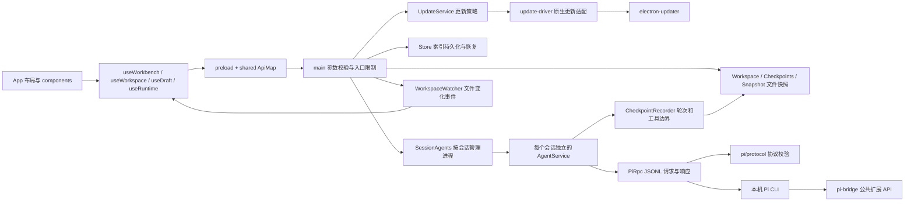

# Pi Desktop 的模块边界

桌面端负责项目、草稿、文件快照与界面；Pi 负责模型调用、工具执行和 JSONL 会话。升级 Pi 时，先检查进程协议和桌面扩展，再检查应用行为。

## 界面

- `src/App.tsx` 只组合侧栏、对话、输入框、工作区、设置及恢复提示。
- `src/hooks/useRuntime.ts` 接收 IPC 状态并应用增量更新；`useDraft.ts` 负责草稿、引用、图片、长文本片段与命令选择；`useShortcuts.ts` 负责键盘入口。`useWorkbench.ts` 连接各面板的操作与选中状态，`useWorkspace.ts` 负责文件预览、变更刷新、检查点选择及恢复对话框。
- `src/components/conversation/` 保留消息和 Markdown 的缓存边界，避免把流式更新变成整段历史的重复解析。
- 流式 Markdown 按完整根节点冻结前缀，保留末尾两块以处理列表、表格等续写；引用定义保留全篇语义。超过 16000 字符的未完成块先显示原文，回复结束后完整渲染。轮次导航最多挂载 60 个按钮，方向键、Home/End 可访问全部轮次。
- 轮次和搜索跳转只挂载目标页的最多 80 条消息；前后翻页和“回到最新”保留全部历史的访问入口，工具与重试分组也按页面裁剪。轮次统计缓存工具补丁的增删行数。会话内查找按消息缓存当前查询的位置，只生成当前命中的摘要，关闭查找或切换会话释放缓存。
- `src/features/` 按 Pi 管理页签组织；纯展示函数放在 `src/lib/`。样式拆为 `src/styles/`，入口保持原有加载顺序。
- 搜索缓存、工具分组、语法标记与参数填写放在独立模块；`DiffView` 统一工具卡片和文件面板的差异展示。历史工具对象的 WeakMap 跨流式更新保留，避免每次更新重新生成全部卡片。
- 新面板不要直接复制整个工作台状态；声明它实际需要的属性，组合子面板时使用 `children` 或明确的内容属性。

导航的操作结果与最终选中状态分开：`newSession` 返回创建/复用的会话，`selectSession` 返回历史，都不承诺回复时仍选中它。主进程的 state 广播、bootstrap 和只读 `navigationState` 完成确认共用内存序号，编号时克隆快照；序号不写入索引。界面忽略旧状态，只有最新导航请求的确认快照或更新状态已进入 render 后才开放模型/发送入口。连接与模型操作同时核对原会话、请求代次及最新接收的选中 ID，普通浏览不启动 Pi。

## Pi 升级

1. `shared/pi-version.ts` 是版本提示的唯一来源。`VERIFIED` 为回归使用的版本，不限制可运行的主、次版本线；其他可识别版本（含预发布版）显示“未验证”并允许使用，不宣称已经兼容。
2. `electron/environment.ts` 发现入口、验证 Node 并读取 `--version`。平台路径、Shell 和终端、进程树操作集中在 `electron/platform.ts`。
3. `electron/rpc.ts` 只处理进程、JSONL、请求关联、超时和桌面扩展调用。`electron/pi/protocol.ts` 校验桌面依赖的核心响应字段并转换统计数据。允许新增字段，不猜测字段别名；字段改变时返回明确的不兼容错误。
   stdout 解码逐块查找换行，只在完整记录到达时拼接，避免大条 `get_messages` 响应反复扫描和复制前缀。
4. `electron/pi-bridge.ts` 通过 Pi 的公开扩展 API 提供桌面所需操作。桥接命令与协议版本定义在 `shared/pi-bridge.ts`。调用前检查命令确实注册，连接时核对桥接版本，避免扩展加载失败后把内部命令发送给模型。
5. 开发依赖锁定已验证版本，以便重复测试；每周工作流单独安装 `@latest`，使用真实 Pi 和本地模型接口运行集成与功能测试。开发依赖版本不限制用户运行的 Pi。通过该测试只说明覆盖到的行为兼容，不代表任意扩展都兼容。

版本号不作为拒绝运行的依据；入口无效、版本无法识别或实际协议不兼容时仍报错。遇到协议变化时，先改协议适配和契约测试，再用真实 Pi 验证，不在界面或 AgentService 中添加猜测字段。

## 索引与崩溃恢复

- `electron/store-state.ts` 校验索引中的每条项目、会话及设置。`Store` 串行写入临时文件并原子替换；成功后每隔至少十分钟轮转一份备份，最多三份。
- 损坏文件先保留，再恢复可用备份；单条坏记录不会使其他记录失效。恢复时间和丢弃数量通过独立的 storage 状态传给界面。
- 存储失败后进入只读状态。启动任务前等待必要持久化完成，防止请求先发出去、保存失败才被发现。停止和查看历史、诊断仍然可用。
- 图片索引仍为格式 2：启动时验证内容哈希和格式，保存成功后主进程释放 base64 正文；状态广播仅带引用，由当前输入框按需读取。图片读取与文字恢复分别管理，加载中的附件完成前禁止发送，继续输入、添加附件和切换会话不会丢失旧图片。发送、切换主动 flush 已接收的草稿，跳过 300 ms 合并窗口但仍等待落盘。
- 历史解析每约 4 ms 让出事件循环；按文件身份、大小及修改时间验证缓存，历史缓存按原文件两倍估算不超过 32 MiB，搜索文本不超过 16 MiB，两者最多 200 个文件。超过预算的历史不缓存；返回副本隔离运行中修改。搜索新查询或关闭面板会取消旧扫描。已有完整运行历史时界面不再保留另一份 IPC 历史。
- Pi 意外退出时先把尚未执行的队列文字、图片恢复为草稿，再开放重连；不会自动重发原始提问。用户编辑的续写内容作为一条新消息发送。
- Pi 主进程退出不等于工具进程退出。应用自身成功结束完整进程树后可以恢复；退出时还有运行工具且无法确认清理时，后端与界面都暂停启动、切换及撤销。用户须先在系统中结束残留命令，再重新启动应用。仅刷新窗口或等待不会解除限制；仅重启应用不会结束旧命令。
- 这不是操作系统沙箱，也不负责追踪扩展主动脱离进程树的后台服务。

## 会话切换与模型错误

- `SessionAgents` 为各会话分别保存 `AgentService`。发送、模型切换、审批回复、取消重试和停止操作均指定会话 ID；切换页面只切换显示内容，已有进程继续执行。关闭应用和安装应用更新检查全部会话；环境路径可随时保存，在下一次启动进程时使用。
- 选择会话先发布目标状态；没有实时消息的连接阶段可读取该会话原生 JSONL。选择调用仍等待自身保存和连接完成，同一会话未完成的选择连接共用结果。renderer 按会话 ID 隔离历史、pending 和错误，并拒绝过期读取；发送仍等待目标连接就绪。
- 会话活动时间由真实内容和运行边界更新；仅查看、连接和配置刷新不会调整排序或制造未读。成功历史编辑/导航在最终刷新后记录活动，覆盖操作期间切到其他会话的情况。
- `useRuntime` 按会话保存增量状态，刷新窗口时重新发布所有连接的完整状态。各会话分别处理待完成的操作、错误和通知，后台输出不会覆盖当前页面；较早的慢连接不能覆盖最后一次会话选择。
- `AgentService.ensureConnected()` 管理其所属进程的连接与恢复；`installRpcHandlers()` 安装进程监听；`rebindSession()` 恢复会话状态。分支和克隆使用独立的原生 `SessionManager` 创建新文件，原会话和任务继续运行。普通页面切换不调用原生会话切换。
- Pi 原生 `set_model` 和 `set_thinking_level` 会影响下一次模型请求。桌面先保存会话选择，运行中通过 `Runtime.nextTask` 展示待生效设置；仅在空闲后的新用户任务进入前调用原生接口，工具继续推理、补充和排队消息保持本轮设置。偏好设置和读取使用独立的短队列/在途计数，长命令不锁住设置。
- 配置保存遵守 Pi 原生 `proper-lockfile` 文件锁，并保留 revision 校验与备份。个人范围影响同配置目录的进程，项目范围影响相同工作目录；各进程空闲且读取、偏好设置、审批均处理完毕后加载。资源包安装需相关进程空闲。
- 文件撤销按真实目录的相交关系和已知写入工具目标检查相关任务，写操作先预留目录，防止检查空闲后新任务插入。检查点继续核对分支、文件内容和预览 revision；跨会话并行写入的归属不确定时不默认勾选撤销。
- 原生终端按会话建立锁，交接开始就预留会话，阻止桌面读取入口暗中重连。导出在保存对话框前固定内容，包含已收到的流式文字和工具输出；分享使用独立临时文件。
- 桌面桥接协议第 2 版增加 `desktop_session_start` 事件，用于划分退出钩子和目标启动事件的归属；第 3 版加入结构化审批授权列表。事件缺失时停止复用并重新启动；不能凭延时猜测会话已切换。
- 异步刷新同时检查进程和运行时对象，防止复用同一进程后旧结果覆盖目标会话。会话切换清空审批临时授权，断开操作与受理中的会话操作互斥。
- `shared/errors.ts` 提供纯分类和脱敏函数；Agent 仅对模型请求错误分类并计数，`ModelErrorCard.tsx` 展示描述和动作。设置、存储、进程错误不进入模型分类器。操作仍通过既有 IPC 执行。
- 诊断记录最近一次复用/重启及原因、后端耗时和最近五次模型错误的类别/时间。端到端切换耗时由真实界面测试单独记录。

## 轮次检查点与工作区

- `CheckpointRecorder` 把 Pi 公开扩展事件转换成桌面检查点操作。普通提问发送前准备检查点；真正到达用户消息的 `message_start` 时绑定时间戳。排队消息等前一轮工具结束后才捕获。Pi 会等待扩展返回，失败时停止这一轮，不依赖事后收到的渲染事件补拍快照。
- `electron/checkpoints.ts` 管理每个会话的轮次序号、保留期限、增量清单和共享 Git 对象；`snapshot.ts` 负责原始文件内容保存。私有对象和索引存放在应用数据目录，项目 Git 历史与索引保持原样。
- 写入和命令执行前后记录文件状态，区分 Pi 修改与手动修改。同一项目的不同会话同时写入或执行命令时，无法区分来源的文件在撤销预览中视为外部修改，默认不选中。恢复预览包含当前文件状态的 revision；确认前再次验证，文件已变化则拒绝本次恢复。恢复选中文件与回到历史消息是两次明确操作。
- `WorkspaceWatcher` 只监听选中项目，过滤构建目录并合并文件事件。界面收到事件后刷新变更；已打开的代码只提示过期，由用户刷新并保留滚动位置。空闲时不再每几秒启动 Git。
- `shared/attachments.ts` 定义路径和行范围；后端统一验证路径、敏感文件、源文件及片段大小。文件选择器、Markdown 行链接和差异片段使用同一格式。

## 授权、模板与本地用量

- `shared/approval.ts` 只识别明确的安全命令前缀；有重定向、管道、变量或复合语法时只授权完整命令。`approval-paths.ts` 解析真实路径和敏感目标，使用 `pi/tool-path.ts` 对齐已验证 Pi 的路径规则。授权只存在当前 Pi 会话内，切换与撤销时清空或删除。
- `electron/prompts.ts` 直接维护 Pi 原生 Markdown 模板和 YAML frontmatter，不建立另一套模板数据库。可编辑范围由实际资源目录、来源与真实路径共同确定；更新和删除验证 revision，包资源保持只读。
- `shared/draft.ts` 记录长文本片段在草稿中的位置。发送、外部编辑和退出保存均保留片段；片段不是丢弃正文的视觉占位符。
- `pi/session-usage.ts` 读取 Pi 的实际 usage 记录，包含历史分支、压缩及嵌套工具开销；缺失的 token 或价格不猜测。`shared/usage.ts` 按最后活动时间选择今日/七天会话后汇总整份会话费用，这不是供应商账单的逐日消费统计。
- 清理空会话先展示原生确认框，确认后重新检查。活动连接、置顶、草稿、文本片段、附件、图片、自定义名称、工作目录、模型与审批配置、用量和非空历史文件都会保留；只移除可清理的桌面索引记录。新建与启动入口用 Store 的进程内临时标记创建空白占位；只有同一作用域内仍带标记、未连接且未使用的占位才可复用。普通 createSession、加载、导入、分支和恢复默认正式保留，历史空白不会被推断成临时入口。显式内容与设置操作在首次等待或入队前不可逆地去掉标记，并在启动 Pi 前排入原有写盘队列。Store 保存时同步投影正式会话，索引和备份使用同一快照；编号状态快照另保留当前选中的临时入口，隐藏其余临时入口但不移除真实对象或 ID，因此延迟草稿仍能找到原会话且不会改变当前选择。搜索、用量和确认清理只枚举正式会话；显式删除或移除项目会清除相应临时标记，不建立缓存或复活路径。正常退出还会等待全局写队列，覆盖没有 AgentService 的首次草稿。

## 桌面应用更新

- `shared/app-update.ts` 定义独立更新状态、安装方式、稳定版版本比较和官方 Release 地址。更新状态通过 `update` 事件推送，不混入 Pi 的消息与工具状态。
- `electron/updater.ts` 管理检查间隔、通知与自动下载模式、重试、安装前检查。它不依赖 Electron；`electron/update-driver.ts` 单独把 `electron-updater` 的事件和安装接口转换为桌面使用的接口。
- `main.ts` 提供具体安装方式、网络请求、忙碌判断和安装前保存步骤。已接收但尚未切换运行状态的 IPC 与 Agent 操作同样阻止安装，避免“刚点击发送，更新先关闭了应用”。开始准备安装后禁止新操作，先保存草稿、断开空闲 Pi 并等待写盘，再交给安装器；系统关机不触发安装。
- `Updates.tsx` 组合侧栏提示、更新说明和“关于与更新”，展示失败原因及重试入口。支持自动替换的安装方式只有 Windows NSIS 和 Linux AppImage；其余方式通过 GitHub Release 接口检查并提示手动下载。
- `Store` 记录最后写入的 `appVersion`。升级前保存原始索引并保留三份；未知的较新格式直接只读打开，不按损坏文件重命名，也不投影后写回旧格式。已知格式允许降级使用。
- `electron-updater` 由 esbuild 一起打入主进程。发布依旧只包含 `build.files` 白名单，CI 校验更新清单中的版本、文件与 SHA-512 后才上传 Release。
- Windows 更新以当前运行的 `exe` 所在目录作为安装目标。运行目录与注册安装目录不同时，`build/installer.nsh` 先校验全部解压文件，再覆盖当前目录的程序文件，保留另一份程序的文件、版本、安装登记和快捷方式；注册目录内的更新仍走正常安装流程。`after-sign.mjs` 为最终文件生成 SHA-512 校验清单；当前只允许用户级安装，不打包提权工具。更新后直接启动本次更新的程序，正常安装流程同时修正仍存在的快捷方式，并保留用户主动删除快捷方式的选择。
- `test:update` 验证旧快捷方式及两个程序目录同时存在的情况，其中目录更新使用含空格的路径。本机验收直接运行验收目录中的程序，正式开始菜单和任务栏保留安装版入口。未包含此修复的旧版不会传递运行目录，首次自动更新仍可能使用注册目录；需要先将包含修复的完整程序放入预期目录，后续自动更新才能按该目录进行。

## 验证入口

`npm run build` 检查类型和产物；`npm test` 覆盖存储、协议、快照、审批与增量状态。`test:integration` 和 `test:features` 使用真实 Pi、本地模型服务及独立测试目录。三个 UI 套件在本地 Windows 与 CI Linux 上运行，失败截图上传为构建产物。

`node --import tsx scripts/perf-ui.mjs <标签>` 用 500 条消息、100 个工具卡片、60 次更新测量界面更新耗时并保存截图。模块拆分前后应在同一环境比较，不能用不同系统的字体渲染差异判断布局回归。
