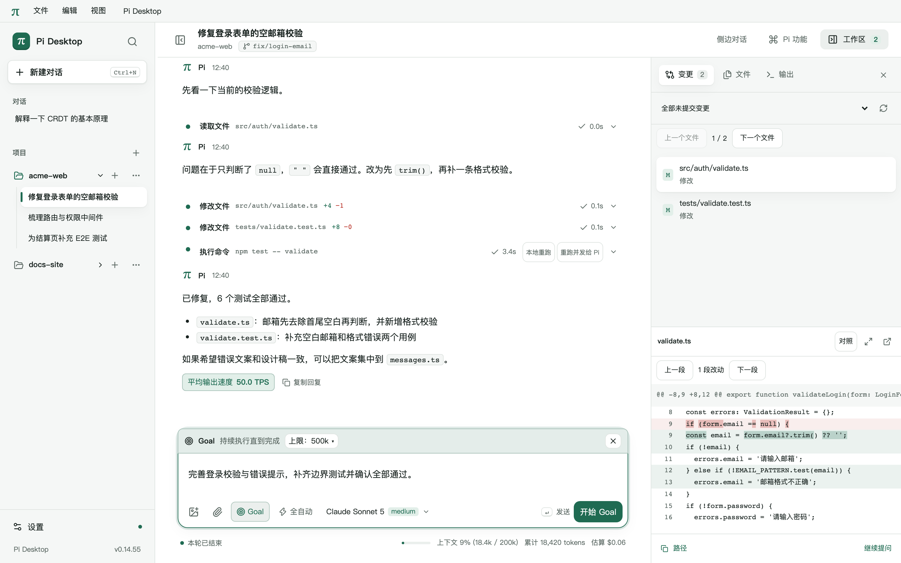

# Goal：持续执行一个目标

Goal 随 Pi Desktop 的桌面扩展加载，使用当前会话的模型执行工作和审计完成情况。一次会话分支保存一个目标；不会自动创建 Goal。

## 使用与进度

点击输入框工具栏的 **Goal**，在现有输入框里填写目标，点击“开始 Goal”或按 Enter。当前草稿中的文件引用、粘贴片段、对话引用和图片会随首条消息一起发送；消息上方显示 `◎ Goal`，原文没有额外前缀。目标正文最多 4000 字，附件不计入；目标状态另保存引用文件的路径。只有附件而没有目标文字时不能开始。

模式条的上限芯片默认“不限”，浮层中可以选择 `500k`、`2m`、`5m` 或自定义正整数。进入模式、写草稿和选择预算不连接 Pi。模式及预算随会话草稿保存，切换会话、重新打开应用后保留；退出模式时预算重置。发送时沿用普通消息的连接、模型能力、存储、文件和图片检查，失败或取消替换时保留草稿。

`/goal <目标>` 会显示同样的创建预览。手写 `--tokens` 优先，通过芯片修改会同步更新参数。按 `Esc` 先关闭建议列表或上限浮层，再退出 Goal 模式；退出命令预览会去掉 `/goal` 和前置预算参数，保留实际目标和附件。

状态条保持一行。有计划时显示当前步骤，没有计划时显示累计执行用时；设置上限时同时显示用量进度。展开详情可查看目标、计划、结果摘要及用量。详情最多占窗口高度的 40%，按 `Esc` 收起。

**编辑目标**在输入框内使用单独的文字草稿，普通草稿和全部附件暂存；保存或取消后完整恢复，切换会话、重启也保留。编辑模式只修改目标文字，新增材料请在完成或取消编辑后补充发送。过期的目标版本会拒绝保存并保留编辑文字。修改保留累计用量和用时，递增目标版本并清空旧计划、旧摘要和无进展计数。运行中通过补充消息送达新目标，对话显示“目标已修改”；旧版本的模型工具调用会被拒绝。编辑已完成或受阻的目标后，点击继续再执行。替换未完成目标需要确认，取消保留原目标；替换清空的是 Goal 进度记录，已修改的文件保留。

完成后 8 秒内没有展开或悬停，状态条收起。Goal 按钮进入新建模式，旁边的圆点“查看上个 Goal 结果”展开之前的结果。已有未完成目标时，Goal 按钮或裸 `/goal` 展开状态卡，详情中的“替换目标”进入创建模式。“跳到结果”定位对应工具卡，兼容旧版完成卡。`×` 清除目标；清除未完成目标会先确认。

| 命令 | 行为 |
| --- | --- |
| `/goal` | 未完成目标展开状态卡；没有目标或已完成时切换输入框 Goal 模式 |
| `/goal status` | 显示目标摘要，不请求模型 |
| `/goal [--tokens N] <目标>` | 创建目标；未完成目标需要确认替换 |
| `/goal edit [新目标]` | 编辑目标；未提供新文本时进入输入框编辑模式 |
| `/goal pause` | 暂停并停止当前运行，保留进度 |
| `/goal resume` | 恢复目标，保留用量和用时，重置无进展与失败计数 |
| `/goal clear` | 清除目标并停止该目标的执行 |

`N` 是正整数，可带 `k` 或 `m`。控制子命令不能附带文件、图片、片段或引用；应用会保留草稿并提示先处理这些材料。开始新会话的 Goal 时，标题取目标首行前 28 字。



## 完成和停止

没有固定的续跑次数或用时上限。每次开始、恢复和自动续跑都注入完成审计：保持完整范围，从目标和引用文件逐项核对当前工作区、测试与运行结果，不能把“不确定”当成完成。目标被编码为数据，不能提升为更高优先级的指令。

- `completed`：模型审计通过后提交完成摘要。普通文字“已完成”不会结束 Goal。
- `blocked`：同一阻碍连续出现 3 个 Goal 轮次后，由模型报告；连续 3 次自动续跑没有实际工具活动，或只有失败命令而没有成功工具，也会进入此状态。可继续或编辑目标。
- `paused`：用户暂停、停止或按 `Esc`；普通模型错误、扩展工具被停用和重新载入也会暂停。
- `budget_limited`：达到用户设置的用量上限，先收尾。点击“调整上限并继续”提高上限或改为不限。
- `usage_limited`：服务商返回额度不足错误。可以打开服务商设置，处理后继续；普通临时限流沿用模型错误分类和暂停提示。

只有 `active` 自动续跑。获取 Goal 或仅更新计划不算实际工作进展。模型的阻碍审计和完成审计仍由当前工作模型负责，应用不能证明所有业务要求已经正确实现；工具结果和测试输出保留在对话中供复核。

达到上限时不立即中断正在执行的工具，而是发送一次隐藏的收尾提示，要求停止新工作、说明进展、剩余问题和下一步。收尾后不再续跑；若模型继续发起超过 3 次请求，会中止运行。回复结束后才能获得准确用量，因此上限可能被当前请求和收尾请求超出，不能作为精确费用上限。

Goal 结束、受阻、达到上限或额度不足时，系统通知在现有“完成时通知”设置下显示对应状态。

## 用量和用时

Goal 用量累加 Pi 上报的 `input + output + cacheWrite`，不含缓存命中 `cacheRead`。详情显示该口径，悬停可查看包含缓存的计费用量及供应商上报的估算费用。上限浮层的请求次数估算采用相同口径。底部会话累计和费用统计保持原口径。

例如每次请求包含输入 1000、输出 500、缓存读取 90000，10 次请求的 Goal 用量为 15k，计费用量为 915k。

用时仅累计本应用运行期间 Goal 为 `active` 的时间，暂停、受阻、预算停止和关闭应用期间不计。旧版记录保留原用量并标注“旧版统计口径，用量可能偏大”，旧证据合并到摘要，用时显示“—”，不伪造无法恢复的历史时间。

## 保存、工具与恢复

状态通过 Pi 原生会话条目保存，计划随当前分支恢复。打开历史不会连接或请求模型；重启、重连、重新加载或切换分支后，原执行中的目标恢复为暂停，须点击继续或使用 `/goal resume`。已完成目标恢复为圆点。

三个内置工具均只操作会话状态，在只读模式可用：

- `desktop_goal_get()`：核对目标、版本、状态、用量、剩余上限及计划。
- `desktop_goal_update({ goal_id, revision, status, summary })`：状态可为 `completed`、`blocked`、`paused`，摘要最多 2000 字。完成和受阻必须是回复中唯一的直接工具调用；暂停只能用于用户明确要求。
- `desktop_goal_plan({ goal_id, revision, steps })`：最多 12 项，同一时间最多一项进行中。

实际文件和命令操作仍遵守原有工具审批。旧版工具仅在历史卡片中保留展示，新运行使用上述工具。

实现使用项目锁定的 Pi 1.4.0 公共扩展 API。续跑位于 `agent_before_settle` 边界，沿用原生工具循环、重试、压缩和队列处理，不制造新的用户轮次。不要同时启用其他注册 `/goal` 的扩展。

## 验证

```text
node --import tsx --test tests/goal.test.ts tests/goal-input.test.ts
npm run build
npm run test:goal
npm run test:goal-ui
```

集成和界面测试使用真实 Pi、本机模拟模型、独立目录和假凭据，不调用付费供应商。验收结果见 [Goal G2 验证记录](testing/goal-redesign.md) 和 [G3 输入框交互验证](testing/goal-composer.md)。
